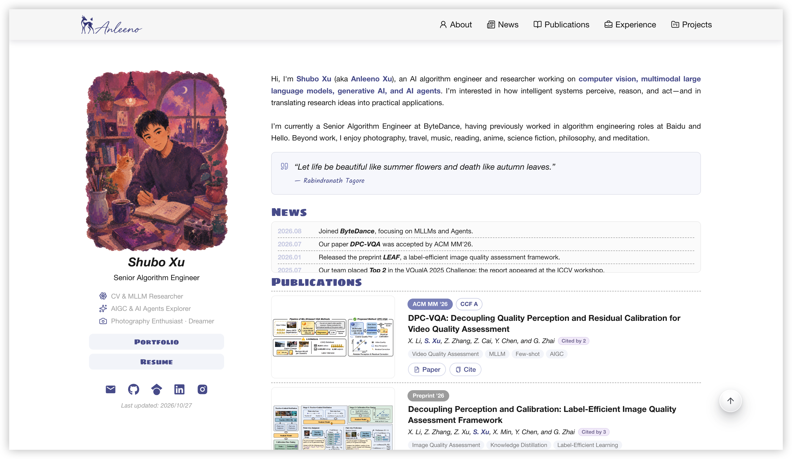

# Anleeno Academic

A responsive academic portfolio template built with React and Vite. It includes a personal profile, news, publications, professional experience, and selected projects.

Live demo: [www.anleeno.com](https://www.anleeno.com)



## Features

- Built with **React 19** and **Vite 7**, with reusable components and data-driven content that keep the codebase organized and easy to customize.
- Fully responsive across desktop, tablet, and mobile, with adaptive navigation, publication layouts, experience timelines, and project cards.
- Rich publication support, including paper links, research tags, one-click citation copying, and optional Google Scholar citation counts.
- Interactive paper preview modals with configurable layouts, research summaries, expandable method figures, result visualizations, and original abstracts. Readers can switch between papers and copy citations within the preview, or open the full text in a new tab. The responsive frosted-glass modal adapts to desktop and mobile; papers without custom preview content use a basic abstract preview.
- Flexible project showcases for images and video, preserving original aspect ratios while maintaining a consistent card layout and hover-to-play interaction.
- A refined interface with glass-effect navigation, smooth section scrolling, contextual color reflections, and a floating back-to-top control.
- Centralized theme settings for coordinated text, accents, buttons, labels, borders, and surfaces without editing individual components.
- Validated JSON/JSONC configuration, with editor schema hints and checks for required fields, asset paths, publication IDs, and preview data before startup and production builds.
- Ready for production with ESLint checks, optimized builds, and automated deployment to GitHub Pages through GitHub Actions.

## Quick Start

Node.js 22 or later is recommended.

```bash
git clone https://github.com/Anleeno/anleeno-academic.git
cd anleeno-academic
npm install
npm run dev
```

Other commands:

```bash
npm run build
npm run preview
npm run lint
npm run validate:config
npm test
```

## Customize

Most site content can be updated through beginner-friendly JSON files. See
[`config/README.md`](config/README.md) for a short editing guide.

| Content | File |
| --- | --- |
| Profile and social links | `config/hero.json` |
| Biography | `config/about.json` |
| News | `config/news.json` |
| Publications | `config/publications.json` |
| Custom paper previews (optional) | `config/publication-previews.json` |
| Experience | `config/experience.json` |
| Education (optional) | `config/education.json` |
| Selected Awards (optional) | `config/awards.json` |
| Projects | `config/projects.json` |
| Theme colors | `config/theme.jsonc` |
| Images, résumé, logos, and video | `src/assets/` |

Education and Selected Awards are configurable and hidden by default. Replace the
sample entries in their JSON files, then set `"enabled": true` to show either
section before Selected Projects. Set `"enabled": false` to hide it without
deleting its content; the corresponding navigation item is hidden as well.
An empty `items` list also hides the section. See the
[configuration examples](config/README.md#education-and-selected-awards).

Citation counts use the Google Scholar social link (`"icon": "scholar"`) in `config/hero.json`. Change it there, or remove that entry to disable fetching. The integration is optional and silently falls back when citation data is unavailable.

Configuration is bundled at build time: rebuild and redeploy after changing it on a published site. Hidden sections are not private storage; do not put credentials or sensitive information in these files.

## Project structure

- `config/`: editable content and theme, with JSON Schemas in `config/schemas/`.
- `src/siteConfig.js`: the shared configuration entry point and asset resolution.
- `src/components/` and `src/css/`: presentation and styling.
- `src/hooks/`: shared interaction lifecycles, including modal opening, scroll locking, and focus restoration.
- `src/utils/`: shared parsing and citation-fetching utilities.
- `scripts/`: configuration validation and regression tests.

Site-wide title, description, language, and copyright name live in `config/site.json`.
Profile content remains in `config/hero.json`. HTML metadata is generated by Vite;
components consume normalized configuration through `src/siteConfig.js`.
Module styles live in matching CSS files (About, News, Projects, etc.);
`index.css`, `App.css`, and `Typography.css` provide base styles, layout, and shared typography.
Avoid adding module-specific rules to global styles.

Paper previews provide five fixed templates selected with `template` in
`config/publication-previews.json`: `basic`, `narrative`, `comparison`, `budget`,
and `challenge`. Configure content, section labels, initial abstract expansion,
and figure background blending without editing components. See the
[template guide and examples](config/README.md#paper-preview-modals).

Large media files can increase deployment time and visitor bandwidth usage. For a reusable fork, consider replacing or externally hosting the included project video.

## Deployment

The included GitHub Actions workflow deploys the `main` branch to GitHub Pages.
Lint, tests, and configuration/build validation must pass before deployment.

1. Open **Settings → Pages** in your repository.
2. Select **GitHub Actions** as the source.
3. Push to `main`.

For a custom domain, replace or remove `public/CNAME` and configure the same domain in the repository Pages settings.

## License

No open-source license is currently granted for this repository.

Unless otherwise stated, all personal content and media assets—including photographs, illustrations, profile information, résumé materials, publication figures, project images, videos, logos, and branding—are © Shubo Xu. All rights reserved. These materials may not be copied, modified, redistributed, or used in derivative works without prior written permission.

Rights to code and materials originating from third-party projects remain with their respective copyright holders.

## Acknowledgements

This project is derived in part from [LucyLing24/longling](https://github.com/LucyLing24/longling).
