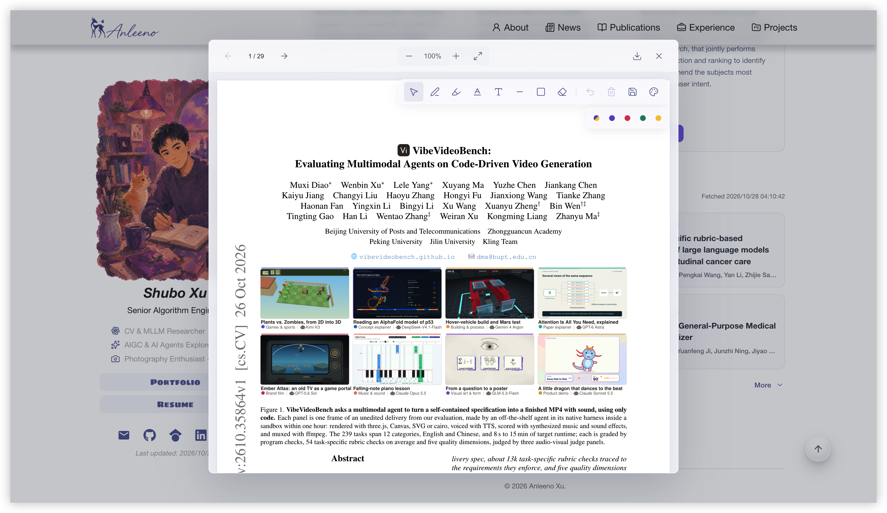
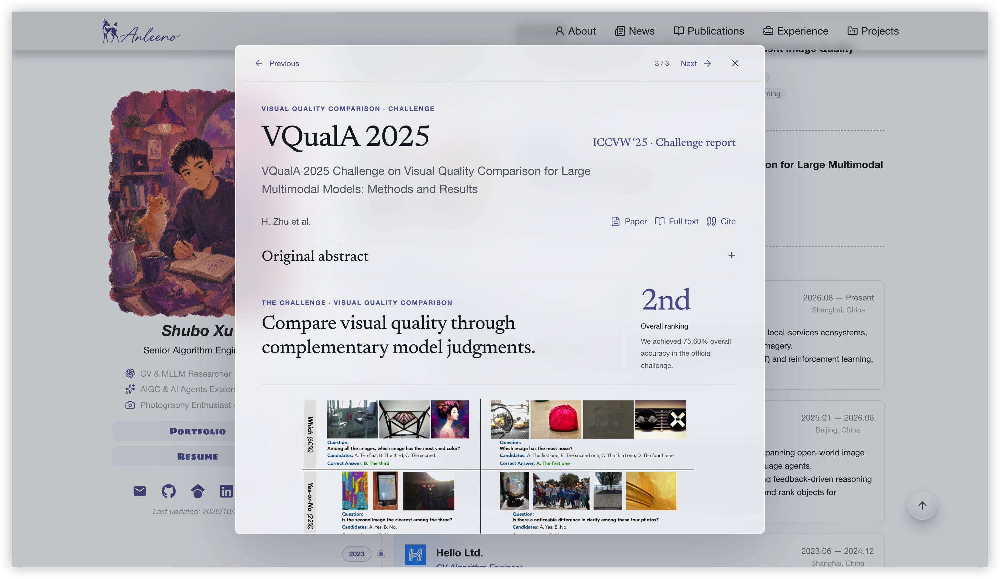
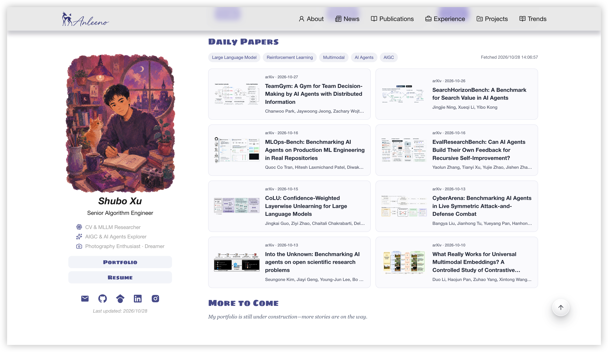

# Anleeno Academic

A customizable academic portfolio built with React and Vite, bringing your profile, research, experience, and projects together with interactive paper previews, an annotated PDF reader, and live paper recommendations.

Live demo: [www.anleeno.com](https://www.anleeno.com)

<p align="center">
  
</p>

<p align="center">
  
  
  
</p>

## Features

- Built with **React 19** and **Vite 7**, with reusable components and configuration-driven content.
- Fully responsive across desktop, tablet, and mobile, with adaptive navigation, publication layouts, experience timelines, and project cards.
- Rich publication support, including paper links, research tags, one-click citation copying, and optional Google Scholar citation counts.
- ✨ **Interactive paper previews** with configurable templates, research summaries, expandable figures, result visualizations, and original abstracts.
- ✨ **Built-in PDF reader and annotations** with page navigation, zoom, text highlighting, freehand drawing, shapes, and text notes. Annotations can be saved locally in the browser.
- ✨ **Live Related Papers** based on each publication's keywords, with links that open in the built-in PDF reader.
- ✨ **Daily Papers** with configurable topic keywords and a More button to show up to eight papers. This section is optional.
- Flexible project showcases for images and video, preserving original aspect ratios while maintaining a consistent card layout and hover-to-play interaction.
- A refined interface with glass-effect navigation, smooth section scrolling, contextual color reflections, and a floating back-to-top control.
- Centralized theme settings for coordinated text, accents, buttons, labels, borders, and surfaces without editing individual components.
- JSON/JSONC configuration with schema validation and editor hints.
- ESLint checks, automated tests, and GitHub Pages deployment through GitHub Actions.

## Quick Start

Node.js 22 or later is recommended.

```bash
git clone https://github.com/Anleeno/anleeno-academic.git
cd anleeno-academic
npm install
npm run dev
```

Other commands:

| Command | Purpose |
| --- | --- |
| `npm run build` | Build the website for publishing |
| `npm run preview` | Preview the production build locally |
| `npm run lint` | Check source code style and common errors |
| `npm run validate:config` | Check configuration files |
| `npm test` | Run automated tests |

## Customize

Most site content can be updated through beginner-friendly JSON files. See
[`config/README.md`](config/README.md) for a short editing guide.

| Content | File |
| --- | --- |
| Site title, description, language, and footer name | `config/site.json` |
| Profile and social links | `config/hero.json` |
| Biography | `config/about.json` |
| News | `config/news.json` |
| Publications | `config/publications.json` |
| Custom paper previews (optional) | `config/publication-previews.json` |
| Related Papers and Daily Papers (optional) | `config/paper-recommendations.json` |
| Experience | `config/experience.json` |
| Education (optional) | `config/education.json` |
| Selected Awards (optional) | `config/awards.json` |
| Projects | `config/projects.json` |
| Theme colors | `config/theme.jsonc` |
| Images, résumé, logos, and video | `src/assets/` |

Education and Selected Awards are configurable and hidden by default. Replace the
sample entries in their JSON files, then set `"enabled": true` to show either
section before Selected Projects. Set `"enabled": false` to hide it without
deleting its content; the corresponding navigation item is hidden as well.
An empty `items` list also hides the section. See the
[configuration examples](config/README.md#education-and-selected-awards).

To show citation counts, set the Google Scholar social link (`"icon": "scholar"`) in `config/hero.json`. Remove that entry to disable citation counts.

Rebuild and redeploy after changing configuration on a published site.

Paper previews provide five fixed templates selected with `template` in
`config/publication-previews.json`: `basic`, `narrative`, `comparison`, `budget`,
and `challenge`. Configure content, section labels, initial abstract expansion,
and figure background blending without editing components. See the
[template guide and examples](config/README.md#paper-preview-modals).

## Project structure

- `config/`: editable website content and theme settings; `config/schemas/` defines their validation rules.
- `src/siteConfig.js`: shared configuration entry point and asset resolution.
- `src/components/`: reusable interface components and paper previews.
- `src/css/`: component styles and shared typography.
- `src/hooks/`: shared interaction logic, including modal behavior and scroll locking.
- `src/utils/`: shared utilities.
- `src/assets/`: images, PDFs, logos, and video.
- `scripts/`: configuration checks and regression tests.

Content and theme settings are separated from presentation components. Update
the configuration files for content changes, and the corresponding component
and stylesheet for layout changes. Keep component-specific styles out of global
stylesheets.

## Deployment

The included GitHub Actions workflow deploys the `main` branch to GitHub Pages.
Lint, tests, and configuration/build checks must pass before deployment.

1. Open **Settings → Pages** in your repository.
2. Select **GitHub Actions** as the source.
3. Push to `main`.

For a custom domain, replace or remove `public/CNAME` and configure the same domain in the repository Pages settings.

For a project URL such as `username.github.io/repository/`, remove `public/CNAME`
and set `base` in `vite.config.js` to `/repository/` before deploying.
Keep `base: '/'` for a custom domain or a `username.github.io` root site.

## License

The website code is available under the [MIT License](LICENSE).
Personal content and media are excluded and may not be reused without permission;
see [content and media terms](CONTENT-LICENSE.md).

Third-party code and materials retain their respective licenses and copyright
notices; this project's license does not override those terms.

## Acknowledgements

This project is derived from [LucyLing24/longling](https://github.com/LucyLing24/longling).
